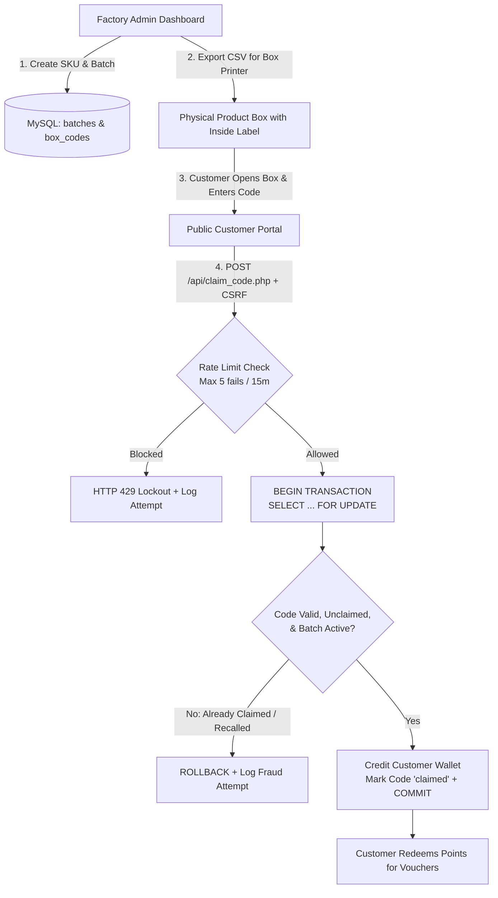
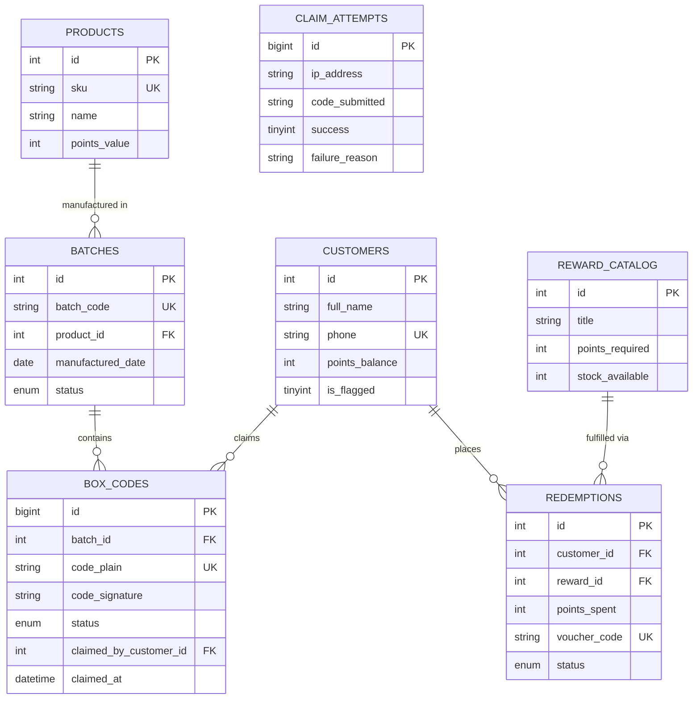

# System Architecture (`ARCHITECTURE.md`)

## 1. Tech Stack & Rationale
* **Backend:** PHP 8.x (with PDO prepared statements) — Zero external framework overhead, runs natively on XAMPP/Apache/Nginx, and supports strict transactional locking (`InnoDB` + `SELECT ... FOR UPDATE`).
* **Database:** MySQL / MariaDB (`InnoDB` engine) — Provides ACID transactions essential for preventing double-spending of box codes and loyalty points under concurrent requests.
* **Frontend:** Semantic HTML5, Vanilla CSS3 (responsive grid layout), and Vanilla JavaScript (`Fetch API`) — Fast load times on mobile browsers when customers scan a box code in-store or at home.
* **Security:** CSRF session tokens, `password_hash()` (bcrypt) for admin credentials, HMAC-SHA256 code signatures, and IP-based sliding-window rate limiting.

## 2. System Flow & Anti-Fraud Diagram

## 3. Entity-Relationship Data Model

## 4. How Core Requirements Are Addressed
1. **Proof of Purchase:** Every box receives a unique `BOX-XXXX-XXXX-XXXX` code generated via `random_int()` and signed with `hash_hmac('sha256')` stored inside the sealed packaging.
2. **Fraud & Reuse Prevention:**
   - **Row-Level Locking:** `api/claim_code.php` wraps verification and point crediting inside a MySQL transaction using `SELECT ... FOR UPDATE`. If two requests submit the same code at the exact same millisecond, the second request waits for the first commit and is immediately rejected as already claimed.
   - **Brute-Force Protection:** `checkRateLimit()` blocks any IP with 5 failed claims within 15 minutes.
   - **Account Freeze:** Admins can flag suspicious customer accounts (`is_flagged = 1`) to block further claims or redemptions.
3. **Factory Owner Monitoring:** `admin/dashboard.php` tracks total codes printed vs. claimed scan rate, exports printer-ready CSVs, allows one-click batch recalls, queues reward redemptions, and displays a live feed of blocked fraud attempts.
